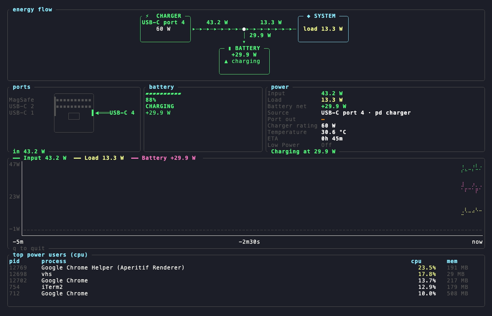
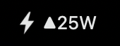
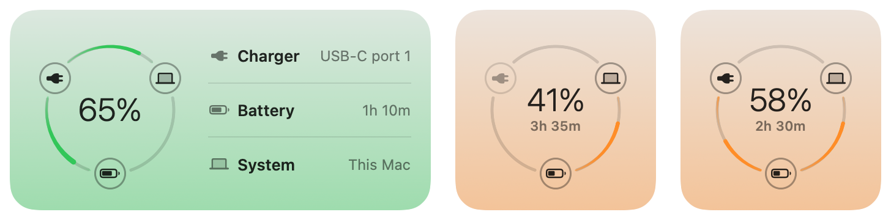

# wattop

A terminal power dashboard for macOS laptops, styled like a hybrid car's energy monitor.

It shows where your watts go: from the charger, into the system and in or out of the battery. It updates live.

https://github.com/user-attachments/assets/0018b7c2-0a43-4c86-a68d-0b52e93f5c55

- **Energy flow:** animated flow between CHARGER, SYSTEM and BATTERY.
- **Battery cell:** the charge level and the state: CHARGING, HOLDING or DISCHARGING.
- **Readouts:** input, load, net battery watts, charger rating, temperature and time left.
- **Port out:** shows a USB-C port that powers a device, such as a phone, and its watts.
- **Low Power Mode:** shows whether macOS Low Power Mode is on, in the dashboard and the menu bar.
- **Warning:** shows when the charger is too weak for the load.
- **History:** a 5-minute graph of input, load and battery watts.
- **Top power users:** the processes that use the most CPU.

## Install

- Download the `.dmg` from [Releases](https://github.com/tupe12334/wattop/releases/latest) and drag Wattop to Applications.
- `cargo install wattop && wattop install-app`
- `cargo install --git https://github.com/tupe12334/wattop wattop && wattop install-app`

Full guide, first launch of the unsigned app, updating and uninstalling: [docs/install.md](docs/install.md).

## Usage

Run `wattop`. Press `q` or `Esc` to quit.

## Limits

The port outline draws only for Mac16,1. The menu-bar app builds for Apple Silicon only.

## How it works

wattop reads power from the SMC and the IORegistry once per second. It needs no root access. It works only on Apple laptops.

See [docs/how-it-works.md](docs/how-it-works.md).

## Menu bar app

Wattop also runs as a menu-bar app. It shows the stats you pick in the menu bar. It has no window.

See [docs/menu-bar-app.md](docs/menu-bar-app.md). To build it from source, see [Install: build from source](docs/install.md#path-4-build-from-source).

## Desktop widget

The app also adds a desktop widget named **Power Flow**. It draws the energy flow between the charger, the battery and the system as a loop, like the energy monitor of a hybrid car. It needs macOS 14 or later.

<picture>
  <source media="(prefers-color-scheme: dark)" srcset="docs/media/widget-dark.png">
  
</picture>

- **Flow:** a lit leg shows where power moves, green from a charger and orange from the battery. Its width follows the watts, and pulses run the way the power moves.
- **Net gain or loss:** the background turns green while the battery gains and orange while it loses.
- **Sizes:** small and medium. macOS draws the glass, dimmed, clear and tinted styles.
- **Battery friendly:** it reloads only while a widget is on screen.

See [docs/widget.md](docs/widget.md).

## Docs

- [Install](docs/install.md)
- [How it works](docs/how-it-works.md)
- [Menu-bar app](docs/menu-bar-app.md)
- [Desktop widget](docs/widget.md)
- [Releasing](docs/releasing.md)
- [Contributing](CONTRIBUTING.md)

## License

MIT
