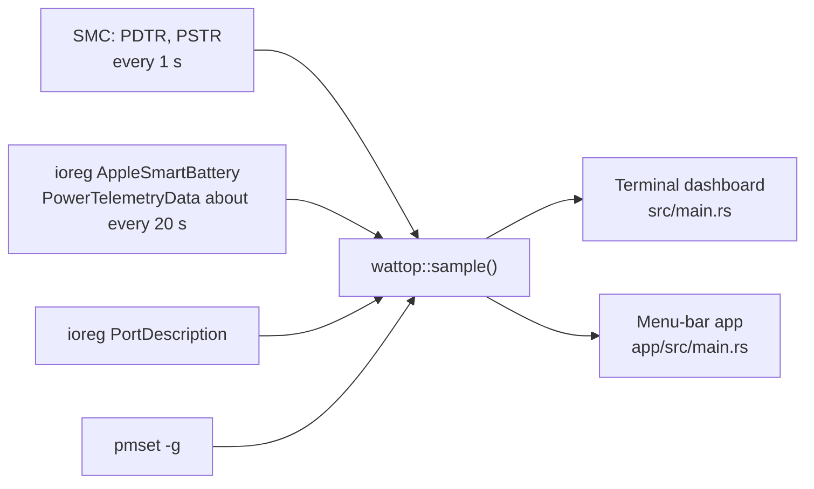
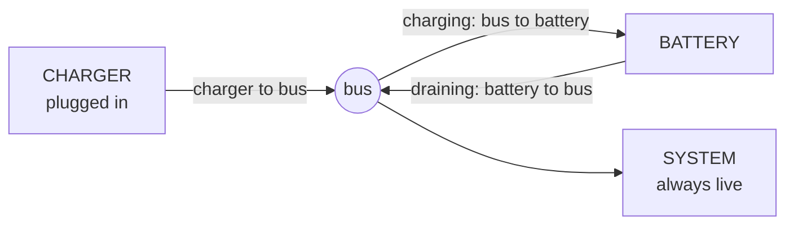

# How wattop gets its data

wattop reads power data from three macOS sources. It needs no root access.

Install steps are in [Install](install.md).

## Sources

| Source | Command or API | What it gives | Code |
| --- | --- | --- | --- |
| SMC, keys `PDTR` and `PSTR` | IOKit `AppleSMC` service | Live input watts and system watts, once per second | [src/smc.rs](../src/smc.rs) |
| Battery entry | `ioreg -rn AppleSmartBattery -a` | Charge, charging state, adapter details, battery watts, temperature, time left | [src/telemetry.rs](../src/telemetry.rs) |
| Ports | `ioreg -r -k PortDescription -d1 -a` | Active power ports, such as `USB-C port 2` | [src/telemetry.rs](../src/telemetry.rs) |
| Port out | `ioreg -rn AppleSmartBattery -a`, key `PowerOutDetails` | Ports that power a device, such as a phone, with watts (V × I) | [src/telemetry.rs](../src/telemetry.rs) |
| Low Power Mode | `pmset -g` | On or off, from the `lowpowermode` line | [src/telemetry.rs](../src/telemetry.rs) |
| Model | `sysctl -n hw.model` | Model id, used to pick a port layout | [src/silhouette.rs](../src/silhouette.rs) |

The `Sample` struct holds the parsed values. See [src/telemetry.rs](../src/telemetry.rs).

## Refresh

Both front ends call one function, `wattop::sample()`. See [src/lib.rs](../src/lib.rs).

- The terminal dashboard samples once per second. It redraws every 200 ms so the flow animation moves. See [src/main.rs](../src/main.rs).
- The menu-bar app samples once per second on a background thread. See [app/src/main.rs](../app/src/main.rs).
- The SMC connection opens once at start. If it fails, wattop uses IORegistry values only.

## Choosing watts: SMC or IORegistry

`sample()` first reads the battery entry. Then it reads live watts from the SMC.

The SMC pair is used only when both values pass these checks. See `apply_live_power` in [src/telemetry.rs](../src/telemetry.rs).

- Both values must be finite and zero or more. A negative value fails.
- The pair is all or nothing. If one value fails, both IORegistry values stay.
- A plugged-in charger with a rating above 0 W cannot deliver 0 W. An input read of 0 W on such a charger fails.

When the SMC pair is used, battery watts equal input watts minus load watts. The IORegistry `BatteryPower` value lags, so it is not used in that case.

If the SMC pair fails, the IORegistry `PowerTelemetryData` values stay. That data updates only about every 20 s.

## Energy flow model

The energy panel shows a bus. The charger feeds the bus. The bus feeds the system. The battery either feeds the bus or receives from it. See `flows()` in [src/flow.rs](../src/flow.rs).

- The bus to SYSTEM is always live.
- The charger line is live when the Mac is plugged in.
- The battery line feeds the bus when the battery drains.
- The bus feeds the battery when the battery charges.
- The battery state comes from `Sample::motion()` in [src/telemetry.rs](../src/telemetry.rs). Battery watts within 0.05 W count as holding. A full battery on a charger also counts as holding: macOS lets it cover small load peaks, then tops it up.
- The "Charger too weak" warning shows only when the battery drains while plugged in, not while it holds.

## Limits

- Apple laptops only. A desktop Mac has no `AppleSmartBattery` entry, so the parser returns an error.
- The port outline is drawn only for layouts in the table in [src/silhouette.rs](../src/silhouette.rs). Today that is `Mac16,1` only. Other models get a plain list of port names.
- Port names come only from `USB-C` and `MagSafe` ports. Other ports are ignored. See `pretty_port` in [src/telemetry.rs](../src/telemetry.rs).
- A device that draws 0 W is not shown as port out.
- The menu-bar app builds for Apple Silicon only. Release files are named `aarch64`. See [.github/workflows/release.yml](../.github/workflows/release.yml).
