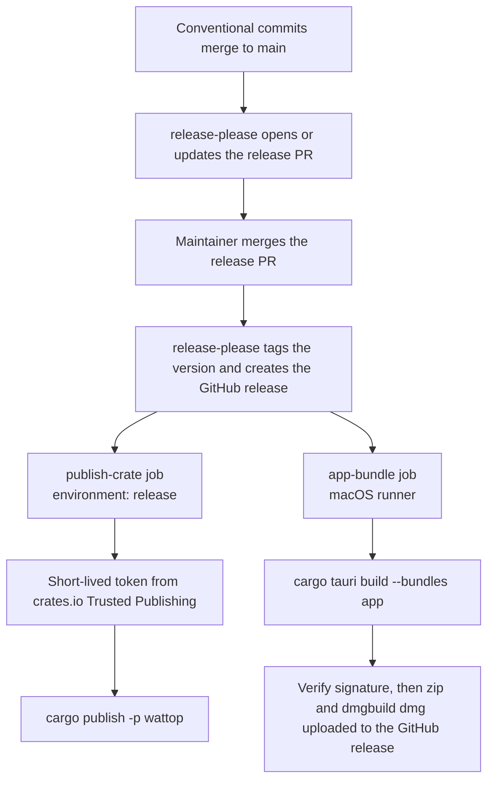

# Releasing

Releases are automatic. Commit messages drive the version. A release PR collects the changes. Merging that PR publishes the crate and builds the app.

Workflow files: [.github/workflows/release.yml](../.github/workflows/release.yml) and [.github/workflows/ci.yml](../.github/workflows/ci.yml). Release settings: [release-please-config.json](../release-please-config.json) and [.release-please-manifest.json](../.release-please-manifest.json).

## Flow



The two jobs after release-please run in parallel. A failed crate publish does not stop the app upload.

## Versioning

release-please reads the commit types. Only these types appear in the changelog: `feat`, `fix` and `docs`. See [release-please-config.json](../release-please-config.json).

- `feat` bumps the minor version.
- `fix` bumps the patch version.
- While the version is below 1.0.0, a breaking change bumps the minor version.

The package list in the config covers the root crate only. The config does not list `app/Cargo.toml` or `app/tauri.conf.json`. Check their version fields in the release PR.

## Publish to crates.io

The job uses Trusted Publishing. It has no stored token.

- The job runs in the GitHub environment `release`.
- The job asks for an OIDC token with `id-token: write`.
- [rust-lang/crates-io-auth-action](https://github.com/rust-lang/crates-io-auth-action) exchanges that token for a short-lived crates.io token.
- The token is passed to `cargo publish` for that step only.

The crates.io crate settings must match the workflow. Set the repository to `tupe12334/wattop`, the workflow file to `release.yml`, and the environment to `release`.

## App bundle

The app job builds the app with `cargo tauri build --bundles app`. Tauri signs it with the identity `-` (ad-hoc) unless the signing secrets exist, see [Signing and notarization](#signing-and-notarization). A `codesign --verify` step checks the seal. It zips the app, and builds the .dmg with [dmgbuild](https://dmgbuild.readthedocs.io) from [app/dmg/settings.py](../app/dmg/settings.py). The layout and background come from [app/dmg/background.tiff](../app/dmg/background.tiff), made by [app/dmg/make_background.py](../app/dmg/make_background.py). It names the files `Wattop-<tag>-aarch64.app.zip` and `Wattop-<tag>-aarch64.dmg`, and uploads both to the release with `gh release upload`.

## Signing and notarization

When all six secrets below exist, the app job:

1. Imports the Developer ID certificate into a temporary keychain. Tauri signs the app and the `wattop` sidecar with hardened runtime.
2. Notarizes the app with Apple and staples the ticket. The zip and the .dmg contain the stapled app.
3. Signs, notarizes and staples the .dmg.
4. Checks the result with `spctl` and `xcrun stapler validate`. The job fails on a rejection.

Without the secrets, the job builds an ad-hoc signed app and does not notarize it. Forks and pull requests never get the secrets. The job fails if only some secrets exist.

The app needs no entitlements file. It starts `ioreg`, `pmset`, `sysctl`, `curl` and `osascript` as child processes. Each child keeps its own signature, so hardened runtime does not block them.

The secrets live in the GitHub environment `release`. The `app-bundle` job uses that environment. Create the environment first, in Settings, Environments, if it does not exist. If it has required reviewers, the app job waits for approval.

| Secret | Value |
| --- | --- |
| `APPLE_CERTIFICATE` | Base64 of the Developer ID Application `.p12` |
| `APPLE_CERTIFICATE_PASSWORD` | Password you set when you exported the `.p12` |
| `APPLE_SIGNING_IDENTITY` | Full identity name, for example `Developer ID Application: Ofek Gabay (TEAMID)` |
| `APPLE_API_ISSUER` | App Store Connect issuer ID |
| `APPLE_API_KEY` | App Store Connect key ID |
| `APPLE_API_KEY_P8` | Contents of `AuthKey_<key id>.p8` |

To create each value:

1. **Certificate.** In Xcode, open Settings, Accounts, select the team, click Manage Certificates, then add **Developer ID Application**. Or create it at developer.apple.com, Certificates. Only the Account Holder can create this certificate type.
2. **`.p12` file.** In Keychain Access, find the "Developer ID Application: ..." certificate under My Certificates. Right-click it, choose Export, and save it as `cert.p12`. Set a password. Then encode the file: `base64 -i cert.p12 -o cert.p12.b64`.
3. **Signing identity.** Copy the certificate name from Keychain Access. Or run `security find-identity -v -p codesigning`.
4. **API key.** In App Store Connect, open Users and Access, Integrations, App Store Connect API. Create a key with the Developer role or higher. Note the key ID and the Issuer ID on that page. Download the `.p8` file. Apple lets you download it once.

Set each secret from a file. Do not type a value on the command line:

```sh
gh secret set APPLE_CERTIFICATE --env release < cert.p12.b64
gh secret set APPLE_CERTIFICATE_PASSWORD --env release < cert-password.txt
gh secret set APPLE_SIGNING_IDENTITY --env release < signing-identity.txt
gh secret set APPLE_API_ISSUER --env release < api-issuer.txt
gh secret set APPLE_API_KEY --env release < api-key-id.txt
gh secret set APPLE_API_KEY_P8 --env release < AuthKey_<key id>.p8
```

Each file must hold only its value. Delete the files after you set the secrets.

## Repository setting

Turn on **Allow GitHub Actions to create pull requests**. Repository settings: Actions, General, Workflow permissions. Without this setting, release-please cannot open the release PR.
