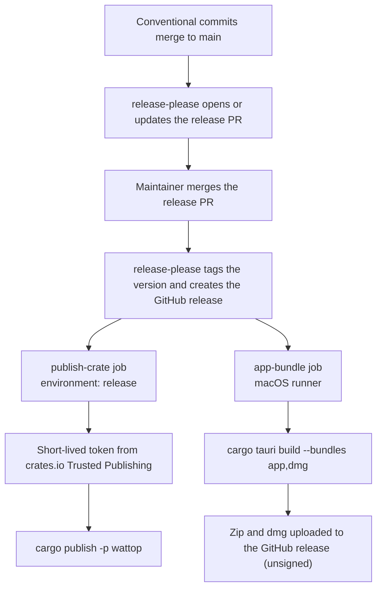

# Releasing

Releases are automatic. Commit messages drive the version. A release PR collects the changes. Merging that PR publishes the crate and builds the app.

Workflow files: [.github/workflows/release.yml](../.github/workflows/release.yml) and [.github/workflows/ci.yml](../.github/workflows/ci.yml). Release settings: [release-please-config.json](../release-please-config.json) and [.release-please-manifest.json](../.release-please-manifest.json).

## Flow

The two jobs after release-please run in parallel. A failed crate publish does not stop the app upload.

## Versioning

release-please reads the commit types. Only these types appear in the changelog: `feat`, `fix` and `docs`. See [release-please-config.json](../release-please-config.json).

- `feat` bumps the minor version.
- `fix` bumps the patch version.
- While the version is below 1.0.0, a breaking change bumps the minor version.

The package list in the config covers the root crate only. The config does not list `app/Cargo.toml` or `app/tauri.conf.json`. Check their version fields in the release PR.

## Publish to crates.io

The job uses Trusted Publishing. It has no stored token.

- The job runs in the GitHub environment `release`.
- The job asks for an OIDC token with `id-token: write`.
- [rust-lang/crates-io-auth-action](https://github.com/rust-lang/crates-io-auth-action) exchanges that token for a short-lived crates.io token.
- The token is passed to `cargo publish` for that step only.

The crates.io crate settings must match the workflow. Set the repository to `tupe12334/wattop`, the workflow file to `release.yml`, and the environment to `release`.

## App bundle

The app job builds an unsigned, not notarized app with `cargo tauri build --bundles app,dmg`. It renames the output to `Wattop-<tag>-aarch64.app.zip` and `Wattop-<tag>-aarch64.dmg`. It uploads both to the release with `gh release upload`.

Users must allow unsigned apps on their Mac. The release does not carry a signature.

## Repository setting

Turn on **Allow GitHub Actions to create pull requests**. Repository settings: Actions, General, Workflow permissions. Without this setting, release-please cannot open the release PR.
